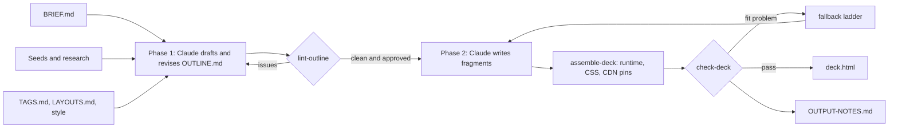

# outline-to-deck reference

Everything about the tool in one place, for people and for AI assistants working on it: what it does, how it is built, every convention, and why it works this way. The knowledge files in `knowledge/` remain the rules Claude follows inside a Project; this document explains them. The catalog tables marked "Generated" come straight from those files (`tools/sync-reference.py`).

## 1. What the tool does

outline-to-deck turns an idea into a presentation in two phases, inside a Claude Project:

1. **Phase 1, Outline.** Claude interviews the presenter (BRIEF.md), researches, and writes a numbered Markdown outline (OUTLINE.md). The outline is revised by section number, reviewed in a fresh chat, and approved.
2. **The gate.** Phase 2 starts only when DECISIONS.md records `Decided · Outline vX.Y approved; Phase 2 begins.`
3. **Phase 2, Deck.** Claude writes slide fragments to a fixed markup contract; the tools assemble them into one self-contained Reveal.js HTML file, check every slide, and record what happened in OUTPUT-NOTES.md.

The outline is written to map onto slides: top-level sections become horizontal slides, subsections become vertical slides below them. Tags in the outline say what each piece of content *is* (a tip, a quiz, a process); the style decides how it looks.

## 2. Architecture



| Work | Done by |
|---|---|
| Research, outline content, proposing tags and layouts, writing Mermaid | Claude |
| Vocabulary, required fields, limits, numbering, counts | `lint-outline.py` |
| Slide content and semantic markup | Claude, to the contract in DECK-BUILD-SPEC.md §4 |
| Reveal setup, chips, labels, icons, cues, page numbers, autofit, Mermaid, layout geometry, charts | `runtime/deck.js`, `layouts.js`, `charts.js` (inlined) |
| Every tag's and layout's look | `runtime/base.css`, `layouts.css`, and the style's CSS (inlined) |
| One file with CDN tags, SRI hashes, fallbacks and inlined images | `assemble-deck.py` |
| Verification | `check-deck.py` |
| Build notes | `write-notes.py` |

## 3. Files

| Path | Purpose | Goes where |
|---|---|---|
| `PROJECT-INSTRUCTIONS.md` | The Project's instructions: read map and always-on rules | Pasted into the Project's instructions |
| `knowledge/BRIEF.md`, `OUTLINE.md`, `DECISIONS.md`, `OUTPUT-NOTES.md` | State files (starters) | Project knowledge; Claude writes them |
| `knowledge/WORKFLOW.md` | Modes, stages, steps, files to open, handoffs, writing rules | Project knowledge |
| `knowledge/OUTLINE-CONVENTIONS.md` | Outline structure, numbering, time plan, writing rules | Project knowledge |
| `knowledge/TAGS.md` | The tag registry | Project knowledge, and in the bundle |
| `knowledge/LAYOUTS.md` | The layout catalog | Project knowledge, and in the bundle |
| `knowledge/DECK-BUILD-SPEC.md` | Phase 2: build steps, markup contract, checks | Project knowledge |
| `knowledge/styles/STYLE-*.md` | Style specs: Base (always) and the active style | Project knowledge |
| `knowledge/styles/*.css` | Style CSS | In the bundle |
| `runtime/` | Shared CSS and JavaScript inlined into every deck | In the bundle |
| `tools/` | Linter, assembler, checker, notes writer, bundle builder, pins | Linter optionally in project knowledge; the rest in the bundle |
| `PROMPTS.md` | Manual-mode prompts | For the presenter |
| `examples/showcase/` | One outline built in all three styles | Repository |
| `teaching/` | v1 workshop material | Repository |
| `docs/` | This reference, the v2 plan, findings, history | Repository |

`deck-tools.zip` (built by `tools/make-bundle.py`) carries everything the tools need into Claude's sandbox, because project knowledge never appears on the sandbox's disk.

## 4. Workflow in brief

- **Modes.** Guided (Claude leads every step, pauses, and says when to start a new chat) or manual (the presenter runs each step with a PROMPTS.md prompt). Same rules and gate in both.
- **Stages.** A Brief → B First outline → C Refine → D Independent review → E Approve → F Deck pass 1 → G Deck pass 2 → H After the build. Claude works out the stage from BRIEF.md's `[TBD]`s, OUTLINE.md's status comment and DECISIONS.md's gate entry.
- **Status comment.** `<!-- status: version 0.3 | phase 1 | last written 2026-11-15 | approved: no | reviewed: no | deck: none -->`.
- **Files on demand.** Knowledge files aren't preloaded; WORKFLOW.md §5 names the files to open at each step.
- **Writes.** At checkpoints only; re-read before writing; replace in place; report changes by section number; a paste-ready fallback if writing fails.
- **Chats.** One job per chat; fresh chats for the review and for Phase 2; "continue my deck" picks up anywhere.

Details: `knowledge/WORKFLOW.md`.

## 5. Outline conventions in brief

- Parts in order: title line, status comment, header lines, Changes by version, Central message, Time plan, Front matter, numbered topic sections, Source reconciliation, Coverage gaps.
- `## 3.` horizontal slide; `### 3.1` vertical slide; `#### 3.1.1` another vertical slide; nothing deeper.
- Top-level slides start with `Main points:` and 3–5 bullets; walking only the top-level slides gives a complete introduction.
- Numbers are IDs, frozen from v0.2. The time plan sets live order, minutes and priority (Core, Brief, Self-guided).
- One idea per slide; bullets of about 25 words at most; sources, `As of`, `[UNVERIFIED]` and `[TBD: …]` carry the evidence; no names of individuals.

Details: `knowledge/OUTLINE-CONVENTIONS.md`.

## 6. Tags

Five forms, each with one job:

| Form | Syntax | For |
|---|---|---|
| Heading tag | `### 2.4 [Quick check] Title`; working aids at the end: `## 3. Title [All] [Core]` | Whole-slide treatments; outline-only metadata |
| Inline marker | `[TBD: …]`, `[UNVERIFIED]`, `[Seed]`, `As of …`, `([Title](url))` | Facts about one statement |
| Callout | `> [!TYPE] optional title` | A boxed aside |
| Key line | `Key: value` | Directives and slide-type fields |
| Fenced block | ```` ```mermaid ````, ```` ```chart ````, code | Diagrams, chart data, code |

Square brackets are a closed vocabulary. Every tag is either stripped or rendered by every style. Meaning problems (an unknown tag, a missing required field) stop that slide; fit problems fall back and are recorded.

### 6.1 Limits

<!-- generated: limits -->
_Generated from `knowledge/TAGS.md`; edit it there._

| ID | Scope | Rule | Value |
|---|---|---|---|
| `slide-types-per-heading` | heading | slide-type tags per heading | 1 |
| `callouts-per-slide` | slide | callouts per slide | 1 |
| `layouts-per-slide` | slide | layouts per slide | 2 |
| `diagrams-per-slide` | slide | `Diagram:` blocks per slide | 2 |
| `section-layout-share` | section | share of slides with a layout, at most | 0.5 |
| `deck-no-callout-share` | deck | share of vertical slides with no callout, at least | 0.5 |
| `watchout-consecutive` | deck | `WATCHOUT` on consecutive slides | no |
<!-- /generated -->

### 6.2 Working aids (stripped)

<!-- generated: working-aids -->
_Generated from `knowledge/TAGS.md`; edit it there._

| Tag | Form | Where | Meaning |
|---|---|---|---|
| `[Seed]` | Inline marker | End of a bullet or heading | From seed files or the presenter's own input |
| `[Research]` | Inline marker | End of a bullet or heading | From Claude's research |
| Audience tags from BRIEF.md | Heading tag | End of a heading | Who the section is for, e.g. `[All]`, `[Technical]` |
| `[Core]`, `[Brief]`, `[Self-guided]` | Heading tag | End of a heading, and the time plan | Priority. Self-guided sections get a small "self-guided" label in the agenda. |
| `(outline-only working aid)` | Heading suffix | A whole section | Changes by version, Time plan, Source reconciliation, Coverage gaps. Never in the deck. |
| Header lines, Central message | Structure | Top of the outline | Title line, status comment, `**Status:**`, `**Session:**`, `**Facts verified:**`. The central message may go into the title slide's speaker notes. |
| `Main points:` | Key line (label only) | Top-level slide | The label is stripped; its bullets become the slide body. |
<!-- /generated -->

### 6.3 Content markers (rendered)

<!-- generated: markers -->
_Generated from `knowledge/TAGS.md`; edit it there._

| Marker | Syntax | Phase 2 rendering |
|---|---|---|
| Speaker notes | `Speaker notes: text` as a paragraph or bullet | `<aside class="notes">`; never visible on the slide |
| As of | `As of Month D, YYYY` | Footer "As of" label on that slide |
| Source | `([Source title](url))` | Footer source link on that slide; collected into the Sources slide if BRIEF.md asks for one |
| Unverified | `[UNVERIFIED]` or `[UNVERIFIED: reason]` | Small pill beside the claim; the reason goes to speaker notes |
| Placeholder | `[TBD: description]` | Visible chip showing the description; never replaced with invented data |
<!-- /generated -->

### 6.4 Callouts

<!-- generated: callouts -->
_Generated from `knowledge/TAGS.md`; edit it there._

| Type | Default label | Purpose | Proposal rule | Default icon | Limit |
|---|---|---|---|---|---|
| `NOTE` | Note | Useful context | Background that helps understanding but isn't the slide's point | Info circle | 1 per slide |
| `TIP` | Tip | A shortcut or better way to do something | A practical technique that saves time or effort and stands on its own | Lightbulb | 1 per slide |
| `REMEMBER` | Remember | The one thing to keep from this slide | A slide's single most important takeaway, when the slide has several points | Bookmark | 1 per slide; ≤ 2 per section |
| `WATCHOUT` | Watch out | A hazard, common mistake, or cost trap | A mistake attendees are likely to make, or a consequence that's easy to miss | Warning triangle | 1 per slide |
| `UNDERTHEHOOD` | Under the hood | Technical depth that others can skip | A mechanism or detail that explains why, aimed at technical attendees | Gear | 1 per slide |
| `FIELDNOTE` | Field note | A real example, story, or observed result | An anonymized internal example or a published case that grounds an abstract point | Notebook | 1 per slide; ≤ 3 per section |
<!-- /generated -->

<!-- generated: callout-aliases -->
_Generated from `knowledge/TAGS.md`; edit it there._

| Alias | Renders as |
|---|---|
| `IMPORTANT` | `REMEMBER` |
| `WARNING` | `WATCHOUT` |
| `CAUTION` | `WATCHOUT` |
<!-- /generated -->

### 6.5 Slide types

<!-- generated: slide-types -->
_Generated from `knowledge/TAGS.md`; edit it there._

| Tag | Purpose | Proposal rule | Required fields | Optional fields | Limit |
|---|---|---|---|---|---|
| `[Try it yourself]` | A hands-on exercise that also works self-guided | A skill attendees should practice, with a result they can see | `Time:`; `Steps:` followed by numbered single actions; `Expected outcome:` | — | — |
| `[Quick check]` | A fast, low-stakes question to the room | After a section's key concept, when there's a common misconception or a surprising answer | `Question:`; `Answer:` | `Options:` followed by 2–4 bullets | 1 per section |
| `[Myth vs fact]` | Correct common misconceptions directly | When research or seeds surface wrong beliefs the audience likely holds | 1–3 pairs of `Myth:` and `Fact:` lines | — | 2 per deck |
| `[Recap]` | A short recap closing a section | The last vertical slide of a Core section with four or more subsections | `Points:` followed by 3–4 bullets | — | 1 per section |
| `[Quote]` | A sourced quotation worth showing word for word | When a published source states a point more memorably than a paraphrase | `Quote:` (verbatim, ≤ 40 words); `Attribution:` (a role or a publication; never a private individual's name); a source link | `Context:` one sentence | 2 per deck |
| `[Key figure]` | One number that carries the section | A single verified figure central to the section's argument | `Figure:` (number and unit); `Label:` (≤ 8 words); a source link; `As of` | `Context:` one sentence | 1 per section |
| `[Backup]` | Detail held back for questions | Material likely to be asked about but not worth live time | — | — | — |
<!-- /generated -->

`[Demo]` is reserved for v2.1.

### 6.6 Directives

<!-- generated: directives -->
_Generated from `knowledge/TAGS.md`; edit it there._

| Key | Value | Scope | Companions | Proposal rule | Phase 2 |
|---|---|---|---|---|---|
| `Layout:` | A layout name, then optional `; option` parts | The bullet list directly below | Layout fields such as `X axis:` (see `LAYOUTS.md`) | Bullets already fit a layout's shape (see `LAYOUTS.md`) | The list rendered as that layout |
| `Diagram:` | One plain-language sentence describing the diagram | Slide | A ```` ```mermaid ```` block directly below, written by Claude | Content with branches, decisions, loops or interactions that a layout can't show | The diagram, rendered with the style's Mermaid settings |
| `Suggested visual:` | A description | Slide | — | An illustration would explain faster than words | An inline SVG Claude designs; captioned "Illustrative, not measured data" unless drawn from numbers in the outline |
| `Embed:` | An `https://` URL | Slide | Optional `Caption:` | Only when the presenter asks to show a live page | A framed live page; when printed, offline, or if the site refuses framing, a link card |
| `Image:` | A file name from project knowledge or the chat, or an `https://` URL | Slide | Required `Alt:`; optional `Caption:` and a source link | Only for images the presenter supplies | The picture; local files embedded in the deck |
<!-- /generated -->

### 6.7 Fenced blocks

<!-- generated: blocks -->
_Generated from `knowledge/TAGS.md`; edit it there._

| Block | Written by | Placement | Phase 2 |
|---|---|---|---|
| `mermaid` | Claude only | Directly under a `Diagram:` line | Rendered by Mermaid on first view of the slide |
| `chart` | The presenter or Claude, from numbers in the outline | Anywhere in a slide body | An SVG chart drawn by the deck runtime in the style's series colors |
| any other language, or none | The presenter or Claude | Anywhere in a slide body | A code block, shown as written in `--font-code`; keep it to about 12 lines |
<!-- /generated -->

Deck-level options live in BRIEF.md: Layout use (encourage, sparingly, off), Build animations (on, off), Sources slide (yes, no).

## 7. Layouts

Authors write an ordinary bullet list; one line above it picks the shape:

```markdown
Layout: process; chevron
- Pilot: two teams build a real deck
- **Template: publish the style guide**
- Train: run a workshop
```

An item splits into label and detail at its first `: ` when the text before it is five words or fewer with no markup (`\:` prevents a split). A fully bold item is emphasized. Options: a variant, `build`, `numbered`. Up to two layouts per slide.

<!-- generated: layouts -->
_Generated from `knowledge/LAYOUTS.md`; edit it there._

| Name | Shape | Items | Label words | Detail words | Variants | Fields | Fallback | Renderer |
|---|---|---|---|---|---|---|---|---|
| `list` | list | 2–7 | 6 | 20 | boxes, plain | — | split | html |
| `process` | ordered | 3–7 | 4 | 12 | chevron, arrows, steps | — | list | html |
| `timeline` | dated | 3–8 | 4 | 12 | horizontal, vertical | — | list | html |
| `columns` | columns | 2–4 | 5 | 12 | plain, pros-cons, before-after | — | split | html |
| `hierarchy` | tree | 2–12 | 4 | 0 | top-down, left-right | — | list | html |
| `radial` | radial | 3–8 | 4 | 8 | — | — | list | svg |
| `matrix` | quad | 4–4 | 5 | 15 | plain, axes | X axis, Y axis | list | html |
| `cycle` | ordered | 3–6 | 4 | 10 | — | — | process | svg |
| `pyramid` | ordered | 3–5 | 5 | 10 | — | — | list | html |
| `funnel` | ordered | 3–5 | 5 | 10 | — | — | process | html |
| `venn` | sets | 2–3 | 4 | 8 | — | Overlap | columns | svg |
<!-- /generated -->

<!-- generated: layout-proposals -->
_Generated from `knowledge/LAYOUTS.md`; edit it there._

| Name | Propose when |
|---|---|
| `list` | 2–7 points of equal weight that read better as separate panels than as plain bullets |
| `process` | 3–7 bullets describe steps in order |
| `timeline` | Bullets start with dates or periods |
| `columns` | 2–4 options compared on the same points, or before-and-after, or pros and cons |
| `hierarchy` | Bullets nest to show parts of a whole or reporting lines |
| `radial` | One central idea with 3–8 related parts of equal weight |
| `matrix` | Four items that fall on two axes |
| `cycle` | Steps where the last leads back to the first |
| `pyramid` | Levels that build on each other, most fundamental at the bottom |
| `funnel` | Stages that narrow, such as a pipeline or a filter |
| `venn` | Two or three groups whose overlap is the point |
<!-- /generated -->

**Fit.** In order, stopping at the first that fits: render (autofit down to 0.62em); compact (the runtime tightens and wraps); fall back to the catalog's fallback or split into "(continued)"; plain bullets. Never truncate silently, never reword, never go below the floor. Every step past the first is recorded in OUTPUT-NOTES.md.

Details and the markup contract: `knowledge/LAYOUTS.md`.

## 8. Diagrams

Presenters never write Mermaid. When content has branches, decisions, loops or interactions that a layout can't show, Claude describes the diagram on a `Diagram:` line, confirms it (or lists it in its summary) and writes the Mermaid block below it. To change a diagram, edit the sentence or ask in words. Limits: about 9 nodes (5 when two share a slide), labels of 6 words or fewer, emphasis through the `key`, `good` and `warn` classes, whose colors come from the style. The runtime configures Mermaid at load (otherwise it renders hidden slides with its default theme), renders each diagram when its slide is first shown, and the checker flags clipped labels.

## 9. Styles

- **STYLE-BASE.md** (with `runtime/base.css`) renders every tag and layout and is the plain look. It is always uploaded.
- Every other style says `Extends: Base` and lists only what it changes: role colors, label colors, shape tokens (`--radius`, `--outline-width`, `--outline-color`, `--shadow`), fonts, labels (`--label-*` in its CSS), specific elements, and any **degrades** (a tag it deliberately renders more simply; the linter warns with W120).
- **Required roles:** `--ink`, `--surface`, `--surface-alt`, `--line`, `--caption`, `--accent`, `--accent-tint`, `--on-accent`, `--connector`, `--emphasis`, `--on-emphasis`, `--series-1…5`, and for each callout `--callout-<type>`, `-tint`, `-text`, `-icon`.
- **Contrast:** 4.5:1 for text, 3:1 for icons and connectors.
- **A new style:** copy `STYLE-TEMPLATE.md`, fill in the identity and overrides, ask Claude to write its CSS, build the showcase with it, check every slide.

Included: Base, Field Guide (a trail guide: spruce and moss, notched trail markers) and Toons (an original hand-inked cartoon look: ink outlines, hard shadows, speech-bubble callouts).

## 10. The deck

- One self-contained HTML file that opens from `file://` or any web server.
- Libraries pinned in `tools/pins.json`: Reveal.js 6.0.2 (jsDelivr first, cdnjs fallback) and Mermaid 12.3.0 (cdnjs first, jsDelivr fallback; loaded only when the deck has diagrams), each with an SRI hash per CDN.
- Everything else is inlined: base CSS, layout CSS, the style's CSS, the runtime, and local images as data URIs.
- **Updating a pin:** change the version and URLs in `pins.json` and `package.json`, run `npm install` and `python3 tools/update-pins.py` on a machine that can reach both CDNs, rebuild the showcase in all styles, run the tests.

## 11. Tools

| Tool | Command | Notes |
|---|---|---|
| Linter | `python3 tools/lint-outline.py OUTLINE.md [--knowledge DIR] [--json] [--codes]` | E codes stop a slide; W codes are fit and balance; I codes are notes. Exit 0, 1 or 2. |
| Assembler | `python3 tools/assemble-deck.py build --fragments DIR --style NAME --outline OUTLINE.md --out DECK.html` | Also `replace-topic DECK N FRAGMENT` and `edit DECK --find … --replace …` (each must match once) |
| Checker | `python3 tools/check-deck.py DECK.html [--outline OUTLINE.md] [--shots DIR] [--step] [--json]` | Needs Playwright; serves libraries from `node_modules` |
| Notes | `python3 tools/write-notes.py --outline … --lint lint.json --check check.json --deck … --style … [--fallback …]` | `--previous` and `--rebuilt` for partial rebuilds |
| Bundle | `python3 tools/make-bundle.py` | Writes `dist/deck-tools.zip` with a manifest |
| Pins | `python3 tools/update-pins.py [--check]` | Fills and verifies SRI hashes |
| Reference | `python3 tools/sync-reference.py [--check]` | Regenerates this document's catalog tables |
| Tests | `python3 -m unittest discover tools/tests` | Deck tests run when Playwright and `node_modules` are present |

The parser, linter, assembler and notes writer use only Python's standard library; the checker needs Playwright and Chromium. All tools are libraries with command-line front ends, so they can move into a plugin or a web backend unchanged.

## 12. Verification and build notes

The checker verifies, on every slide in final state: visible; no overflow; no footer collision; diagrams rendered with no clipped labels; no console errors; layouts match their contract with no clipped text; no visible text below 14px; working-aid text never visible; and, with `--outline`, every outline slide present with its layouts and speaker notes. `--step` clicks through every fragment. Names of individuals and screenshots are checked by eye.

OUTPUT-NOTES.md records each build: summary and numbers, fallbacks and workarounds (one row per section), autofit and compaction, placeholders and unverified claims, linter findings, open issues.

## 13. Design decisions

| # | Decision | Why |
|---|---|---|
| D1–D2 | Guided workflow first; stay a Claude Project | The Project combination works; a plugin later removes setup friction |
| D3 | v2 is a usable tool; teaching material in `teaching/` | The workshops are done |
| D4 | One registry; every style renders every tag; styles extend Base | Ends unknown tags and style-switch mapping |
| D5 | `Layout:` marker line above a normal list | Readable on GitHub, several per slide, one line to change |
| D6 | Fit problems fall back; meaning problems stop | Never guess content; never block a build over space |
| D7 | OUTPUT-NOTES.md | Fallbacks and workarounds are visible and keyed by section |
| D8 | Tools take the mechanical work | Consistency across builds; checks that are always run |
| D9 | One self-contained file, libraries from CDNs | Opens anywhere, as v1 did |
| D10 | Claude writes all Mermaid | Presenters shouldn't need diagram syntax |
| D11, D23 | Reveal.js 6.0.2 and Mermaid 12.3.0; Reveal from jsDelivr first | Current releases; jsDelivr files match what the checker tests |
| D12–D21 | Callout set and aliases, new slide types, charts in v2, CDN fallback with SRI, browser floor, scrubbed names, licenses, new repo, layout balance | Decided Nov 26, 2026 |
| D22 | Mermaid's look is per style; Base and Field Guide use classic | The new look adds shadows Field Guide forbids |
| D24 | Tools travel as `deck-tools.zip` | Project knowledge never reaches the sandbox's disk |
| D25 | Instructions carry a read map | Knowledge files are read on demand |

Full log: `docs/V2-PLAN.md` §2; test results: `docs/M0-FINDINGS.md`; earlier designs: `docs/history/`.

## 14. Pitfalls and lessons

- Never set `position` on `.reveal .slides section`; slides silently stack off-screen.
- Configure Mermaid before load completes, or it renders hidden slides with its default theme (blank diagrams).
- Don't start two renders of the same diagram at once; the runtime shares one render per slide.
- Reveal's page background comes from its theme, which decks don't load; `base.css` sets it from `--surface`.
- Screenshots taken during a fade show two slides; the checker turns transitions off.
- The in-chat preview can't load CDN scripts; check in a real browser or with the checker.
- Name the presenter; say seeds are leads; give rules that apply everywhere their own section; follow the approved change list exactly.
- A rule only applies when its file is open; Claude must open the files each step names.

## 15. Glossary

| Term | Meaning |
|---|---|
| Brief | BRIEF.md: everything specific to one presentation |
| Gate | The DECISIONS.md entry that opens Phase 2 |
| Horizontal / vertical slide | Reveal.js's two dimensions: topics left to right, detail below each |
| Fragment | (1) A slide-markup file Claude writes per topic; (2) Reveal's click-to-reveal element |
| Working aid | An outline-only tag, always stripped |
| Degrade | A tag a style deliberately renders more simply |
| Role token | A CSS custom property every style must define, such as `--accent` |
| Fallback ladder | The order of fit remedies: compact, fall back, split, plain bullets |
| Bundle | `deck-tools.zip`, the tools attached to a chat |
| Read map | The table in the project instructions naming which files to open when |
