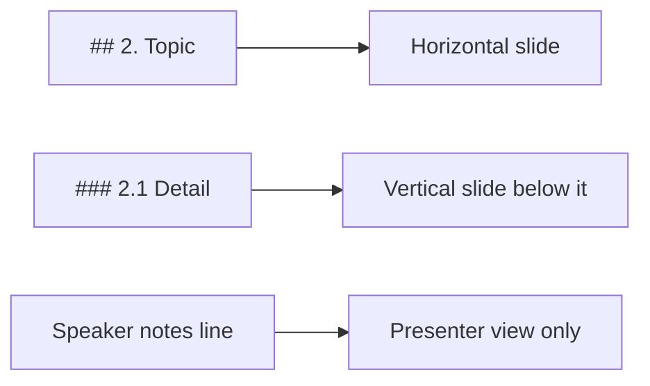

# OUTLINE — Outline to deck: write it, tag it, build it once

<!-- status: version 1.0 | phase 2 | last written 2026-11-27 | approved: v1.0 | reviewed: v1.0 | deck: complete -->

**Status:** v1.0, approved November 27, 2026. The showcase: it uses every tag family, all eleven layouts and all three chart types, and is built in every style.
**Session:** 25-minute walkthrough
**Facts verified:** November 27, 2026

## Changes by version (outline-only working aid)
- v1.0: showcase outline for outline-to-deck v2.

## Central message
Get the content right in cheap text, tag each part with what it is, and let the deck be generated once from that.

---

## Time plan (outline-only working aid)

| # | Section | Full (min) | Live (min) | Priority |
|---|---|---|---|---|
| — | Title and agenda | 1 | 1 | Core |
| 1 | Why outline first | 5 | 4 | Core |
| 2 | Phase 1: the outline | 7 | 6 | Core |
| 3 | Tags | 5 | 4 | Core |
| 4 | Layouts | 6 | 4 | Core |
| 5 | Styles | 4 | 3 | Brief |
| 6 | Phase 2: the deck | 4 | 0 | Self-guided |
| — | Q&A | — | 3 | |
| | **Total** | 32 | 25 | |

---

## Front matter: Title and agenda [All]
- Title: Outline to deck: write it, tag it, build it once
- Series: outline-to-deck showcase
- Framing line: One Markdown outline, three styles, one self-contained deck.
- Speaker notes: Every slide in this deck comes from examples/showcase/OUTLINE.md.

---

## 1. Why outline first [All] [Core]

Main points:
- Text is cheap to write, revise and re-read; a finished deck is expensive on all three. [Seed]
- Every "redo the deck" pays for the whole deck again. [Seed]
- Coding agents are advised to work the same way: plan in text, approve, then build. [Research] ([Claude Code best practices](https://code.claude.com/docs/en/best-practices))
- Typical full-deck rebuilds per talk on your team: [TBD: number of rebuilds per talk]

> [!REMEMBER]
> Iterate on the outline. Build the deck once.

Speaker notes: Ask how many times people have rebuilt a deck from scratch in the last month.

### 1.1 The cost of rebuilding [All] [Seed]
- Suggested visual: cumulative effort over six revisions, outline revisions staying low and full-deck rebuilds climbing, illustrative.
- Revising an outline touches a few hundred words; revising a built deck means regenerating and re-checking every slide. [UNVERIFIED: not measured; based on the size of each artifact]

### 1.2 [Myth vs fact] What people believe about decks [All]
Myth: Starting with slides is faster.
Fact: It feels faster, but slides built before the content settles have to be redone when it changes.
Myth: An outline is extra work.
Fact: The outline becomes the deck's structure, speaker notes and source list.

### 1.3 [Quote] Content first [All]
Quote: Text is cheap to write, revise and re-read; a generated deck is expensive on all three.
Attribution: outline-to-deck WORKFLOW.md
([outline-to-deck: WORKFLOW.md](https://github.com/terrytompkins/outline-to-deck/blob/main/knowledge/WORKFLOW.md))

### 1.4 [Backup] Where the effort goes [All] [Seed]
- Outline revisions: wording, order, facts and sources.
- Deck rebuilds: every slide regenerated, re-checked and re-reviewed.

---

## 2. Phase 1: the outline [All] [Core]

Main points:
Layout: process
- Brief: who, why, how long [Seed]
- Outline: research and write v0.1 [Seed]
- **Review: a fresh chat checks it** [Seed]
- Approve: record the gate [Seed]

### 2.1 Structure maps to slides [All]
Diagram: Top-level sections become horizontal slides, subsections become vertical slides below them, and speaker notes go to the presenter view only.


> [!TIP]
> Freeze numbering from v0.2 on. New sections get the next number; the time plan sets the order.

### 2.2 The approval gate [All]
- DECISIONS.md logs dated decisions as Proposed or Decided.
- The gate line: `Decided · Outline v1.0 approved; Phase 2 begins.`

> [!WATCHOUT]
> Without the gate line, a casual "can I see a slide?" starts Phase 2 early and the deck drifts from the outline.

### 2.3 [Quick check] Where does a speaker note end up? [All]
Question: An outline line starts with `Speaker notes:`. Where does it appear in the deck?
Options:
- On the slide, in small text
- In the presenter view only
- In the agenda
Answer: In the presenter view only. It is never visible on the slide.

### 2.4 [Try it yourself] Tag one section [All]
Time: 5 minutes
Steps:
1. Pick a section of a talk you are working on.
2. Rewrite it as `## N. Title` with three main points.
3. Add one callout where it fits: a tip, a hazard or something to remember.
Expected outcome: a section that already reads like a horizontal slide, with one tag the deck will render.

### 2.5 [Recap] Phase 1 in three points [All]
Points:
- Numbered sections become slides.
- State files, not chat history, carry progress.
- Approval is a recorded decision.

---

## 3. Tags [All] [Core]

Main points:
- A tag says what a piece of content is; the style decides how it looks. [Seed]
- Callouts use GitHub's alert syntax, so outlines stay readable. [Research] ([GitHub: alerts](https://docs.github.com/en/get-started/writing-on-github/getting-started-with-writing-and-formatting-on-github/basic-writing-and-formatting-syntax#alerts))
- One registry, TAGS.md, defines every tag. [Seed]

### 3.1 Five forms [All]
Layout: list; numbered
- Heading tag: whole-slide treatments
- Inline marker: facts about one statement
- Callout: a boxed aside
- Key line: directives and fields
- Fenced block: diagrams and charts

### 3.2 Four kinds of tag [All]
Layout: matrix; axes
X axis: Hidden → shown
Y axis: Inline → slide
- Working aids: stripped from the deck
- Content markers: footers, chips, notes
- Slide types: whole designed slides
- **Callouts: boxed asides**

### 3.3 Six callouts [All]
Layout: radial
- **Callouts**
  - Note
  - Tip
  - Remember
  - Watch out
  - Under the hood
  - Field note

> [!UNDERTHEHOOD]
> GitHub shows five alert types itself; the others appear there as plain quotes. The deck gives every type its look.

---

## 4. Layouts [All] [Core]

Main points:
- Authors write bullets; one `Layout:` line picks the shape. [Seed]
- Eleven layouts, each with limits and a fallback. [Seed] ([outline-to-deck: LAYOUTS.md](https://github.com/terrytompkins/outline-to-deck/blob/main/knowledge/LAYOUTS.md))
- Nothing is truncated or reworded to fit. [Seed]

### 4.1 [Key figure] Layouts in the catalog [All]
Figure: 11
Label: SmartArt-style layouts, from lists to Venn
Context: Each one renders in every style.
([outline-to-deck: LAYOUTS.md](https://github.com/terrytompkins/outline-to-deck/blob/main/knowledge/LAYOUTS.md)) As of November 27, 2026

### 4.2 How v2 came together [All]
Layout: timeline
- Nov 9: first workshop
- Nov 15: guided workflow
- Nov 25: v2 plan
- **Nov 27: v2 build**

### 4.3 Revise until ready [All]
Layout: cycle
- Draft
- Lint
- **Review**
- Revise

### 4.4 What a deck rests on [All]
Layout: pyramid
- Deck: what people see
- Style: how it looks
- Tags: what each part is
- **Outline: the content**

### 4.5 From ideas to slides [All]
Layout: funnel
- Ideas: everything you could say
- Outline: what the talk covers
- Time plan: what fits live
- **Deck: what you show**

### 4.6 Where the deck comes from [All]
Layout: venn
Overlap: The deck
- Content: the outline
- Look: the style

### 4.7 Parts of a deck [All]
Layout: hierarchy
- Deck
  - Title and agenda
  - Topics
    - Horizontal slides
    - Vertical slides
  - **Appendix**
    - Backup slides

---

## 5. Styles [All] [Brief]

Main points:
Layout: columns
- Base
  - Plain and quiet
  - Any talk
- Field Guide
  - A trail guide
  - Teaching sessions
- Toons
  - Hand-inked cartoon
  - Internal events

### 5.1 Readable labels [All]
```chart
type: column
title: Callout label contrast in Field Guide, v1 and v2
unit: ratio
| Callout | v1 | v2 |
| Tip | 2.0 | 6.3 |
| Watch out | 3.8 | 5.2 |
| Field note | 4.3 | 5.7 |
| Remember | 4.6 | 6.3 |
```
- Body text needs at least 4.5:1 contrast. [UNVERIFIED: WCAG page not re-checked for this showcase] ([WCAG 2.2: contrast minimum](https://www.w3.org/TR/WCAG22/#contrast-minimum))
([outline-to-deck: STYLE-FIELD-GUIDE.md](https://github.com/terrytompkins/outline-to-deck/blob/main/knowledge/styles/STYLE-FIELD-GUIDE.md)) As of November 27, 2026

> [!FIELDNOTE]
> Three of Field Guide's v1 callout labels were below 4.5:1. v2's style schema gives every label its own darker text color.

### 5.2 Before and after a style switch [All]
Layout: columns; before-after
- v1
  - Map unknown tags
  - Fallback tables
- v2
  - Every tag renders
  - Just rebuild

---

## 6. Phase 2: the deck [Technical] [Self-guided]

Main points:
- One self-contained HTML file; Reveal.js and Mermaid from pinned CDN versions. [Research] ([Reveal.js: vertical slides](https://revealjs.com/vertical-slides/))
- The tools build and check it; Claude writes the slides. [Seed]
- Every slide is verified before the deck is called done. [Seed]

### 6.1 Build steps [Technical]
Layout: process; steps
- Lint: check the outline
- Write: slide fragments
- **Assemble: one file**
- Check: every slide
- Notes: record the build

### 6.2 Tests as the tools grew [Technical]
```chart
type: line
title: Automated tests in the repository, by milestone
| Milestone | Tests |
| M2 tools | 44 |
| M3 layouts | 46 |
| M4 charts | 47 |
| M5 workflow | 50 |
```
([outline-to-deck: commit history](https://github.com/terrytompkins/outline-to-deck/commits/main)) As of November 27, 2026

### 6.3 Check every slide [Technical]
```chart
type: bar
title: The twelve checks in the build spec, by kind
| Kind | Checks |
| Fit and footer | 3 |
| Text and tags | 2 |
| Outline match | 2 |
| Errors and clicks | 2 |
| Diagrams | 1 |
| Layouts | 1 |
| Screenshots | 1 |
```
([outline-to-deck: DECK-BUILD-SPEC.md](https://github.com/terrytompkins/outline-to-deck/blob/main/knowledge/DECK-BUILD-SPEC.md)) As of November 27, 2026

### 6.4 [Backup] Running the checker [Technical]
```bash
python3 tools/check-deck.py deck.html --outline OUTLINE.md --shots shots --json
```

---

## Source reconciliation (outline-only working aid)

| Topic | Conflict | Resolution |
|---|---|---|
| (none) | | |

## Coverage gaps (outline-only working aid)
- Showcase only: a tour of the tool, not a complete guide. The Image and Embed directives aren't shown here.
