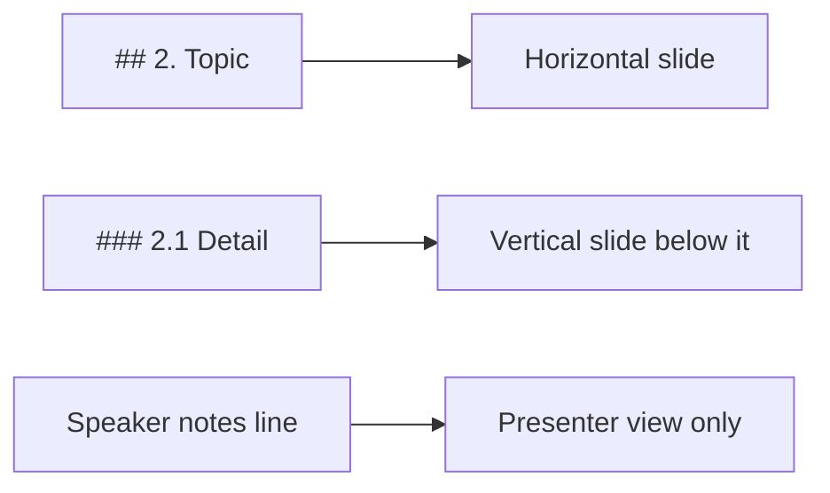

# OUTLINE — Outline first: building better decks in two phases

<!-- status: version 1.0 | phase 2 | last written 2026-11-27 | approved: v1.0 | reviewed: v1.0 | deck: none -->

**Status:** v1.0, approved. Test fixture that uses every tag family at least once.
**Session:** 20-minute demo
**Facts verified:** November 27, 2026

## Changes by version (outline-only working aid)
- v1.0: fixture.

## Central message
Get the content right in cheap text, tag it with what each part *is*, and let the deck be generated once from that.

---

## Time plan (outline-only working aid)

| # | Section | Full (min) | Live (min) | Priority |
|---|---|---|---|---|
| — | Title and agenda | 1 | 1 | Core |
| 1 | Why outline first | 6 | 4 | Core |
| 2 | Phase 1: the outline | 10 | 6 | Core |
| 3 | Tags and layouts | 8 | 5 | Core |
| 4 | Phase 2: the deck | 5 | 2 | Brief |
| — | Q&A | — | 2 | |
| | **Total** | 30 | 20 | |

---

## Front matter: Title and agenda [All]
- Series: Fixture series
- Title: Outline first: building better decks in two phases
- Framing line: Write it, tag it, approve it, then build it once.

---

## 1. Why outline first [All] [Core]

Main points:
- Text is cheap to write, revise, and re-read. A finished deck is expensive on all three. [Seed]
- Every "redo the deck" pays for the whole deck again. [Seed]
- Coding agents are advised to work the same way: plan in text, approve, then build. [Research] ([Claude Code best practices](https://code.claude.com/docs/en/best-practices))
- Typical deck revisions on your team: [TBD: number of full-deck revisions per talk]

> [!REMEMBER]
> Iterate on the outline. Build the deck once.

Speaker notes: Ask how many times people have rebuilt a deck from scratch in the last month.

### 1.1 The cost of rebuilding [All] [Research]
- Suggested visual: cumulative effort over six revisions, text-outline revisions vs. full-deck rebuilds, illustrative.
- Revising an outline touches a few hundred words; revising a built deck means regenerating and re-checking every slide. [UNVERIFIED: not measured; based on the size of each artifact]

### 1.2 [Myth vs fact] What people believe about decks [All]
Myth: Starting with slides is faster.
Fact: It feels faster, but slides built before the content settles have to be redone when it changes.
Myth: An outline is extra work.
Fact: The outline becomes the deck's structure, speaker notes, and source list.

### 1.3 [Key figure] Revisions before a deck settles [All]
Figure: 6
Label: Outline revisions before one deck build
Context: An internal talk, anonymized.
([Example write-up](https://example.com/write-up)) As of November 27, 2026

### 1.4 [Backup] Where the six revisions went [All] [Seed]
- v0.1 to v0.3: structure and scope.
- v0.4 to v0.6: facts, sources and examples.

---

## 2. Phase 1: the outline [All] [Core]

Main points:
Layout: process
- Draft: research and write v0.1 [Seed]
- Refine: revise by section number [Seed]
- **Review: a fresh chat checks it** [Seed]
- Approve: record the gate [Seed]

### 2.1 Structure maps to slides [All]
Diagram: Top-level sections become horizontal slides, subsections vertical ones, and speaker notes go to the presenter view.


> [!TIP]
> Freeze numbering from v0.2 on. New sections get the next number; the time plan sets the order.

### 2.2 The approval gate [All]
- DECISIONS.md logs dated decisions as Proposed or Decided.
- The gate line: `Decided · Outline v1.0 approved; Phase 2 begins.`

> [!WATCHOUT]
> Without the gate line, a casual "can I see a slide?" starts Phase 2 early and the deck drifts from the outline.

### 2.3 [Quick check] Where does a speaker note end up? [All]
Question: An outline bullet starts with `Speaker notes:`. Where does it appear in the deck?
Options:
- On the slide, in small text
- In the presenter view only
- In the agenda
Answer: In the presenter view only. It becomes an `<aside class="notes">` and is never visible on the slide.

### 2.4 [Try it yourself] Tag one section [All]
Time: 5 minutes
Steps:
1. Pick a section of a talk you are working on.
2. Rewrite it as `## N. Title` with three main points.
3. Add one callout where it fits: a tip, a warning, or something to remember.
Expected outcome: a section that already reads like a horizontal slide, with one tag you could render.

### 2.5 [Recap] Phase 1 in three points [All]
Points:
- Numbered sections become slides.
- State files, not chat history, carry progress.
- Approval is a recorded decision.

---

## 3. Tags and layouts [All] [Core]

Main points:
- Tags say what a piece of content *is*; the style decides how it looks. [Seed]
- Callouts use GitHub's alert syntax, so outlines stay readable. [Research] ([GitHub: alerts](https://docs.github.com/en/get-started/writing-on-github/getting-started-with-writing-and-formatting-on-github/basic-writing-and-formatting-syntax#alerts))
- One `Layout:` line turns bullets into a designed shape. [Seed]

### 3.1 Four kinds of tag [All]
Layout: matrix; axes
X axis: Outline only → in the deck
Y axis: Inline → whole slide
- Working aids: stripped from the deck
- Content markers: footers, chips, notes
- Slide types: whole designed slides
- Callouts: boxed asides

### 3.2 Choosing a style [All]
Layout: columns; pros-cons
- Base
  - Plain and quiet
  - Works for any talk
- Toons
  - Playful and loud
  - Internal sessions only

> [!NOTE]
> Every style renders every tag.

### 3.3 [Quote] Why plain text first [All]
Quote: Plan in text, approve the plan, then build.
Attribution: Coding-agent guidance
([Claude Code best practices](https://code.claude.com/docs/en/best-practices))

### 3.4 Wait time by pull-request size [Technical]
```chart
type: bar
title: Hours to first review, by pull-request size
unit: hours
| Size | Hours |
| Under 100 lines | 4 |
| 100-500 lines | 11 |
| Over 500 lines | 30 |
```
([Example study](https://example.com/review-study)) As of November 27, 2026

---

## 4. Phase 2: the deck [Technical] [Brief]

Main points:
- One self-contained HTML file; Reveal.js and Mermaid from pinned CDN versions. [Research]
- Build horizontal slides first, then vertical slides by priority. [Seed]
- Verify every slide before calling it done. [Seed]

### 4.1 Verify every slide [Technical]
- Visible, no overflow, no footer collision, diagrams rendered, no console errors.
- Then look at screenshots.

```python
python3 tools/check-deck.py deck.html --shots shots
```

---

## Source reconciliation (outline-only working aid)

| Topic | Conflict | Resolution |
|---|---|---|
| (none) | | |

## Coverage gaps (outline-only working aid)
- Fixture only; not a complete treatment of the method.
